# Melodio Web

<p align="center">
  
</p>

<p align="center">浏览器本地专辑播放器。</p>

<p align="center"><a href="README.md">中文</a> · <a href="docs/README.en.md">English</a> · <a href="docs/README.fr.md">Français</a> · <a href="docs/README.ru.md">Русский</a> · <a href="docs/README.es.md">Español</a> · <a href="docs/README.ja.md">日本語</a> · <a href="docs/README.ko.md">한국어</a></p>

体验地址：<https://kuthorx.github.io/melodio-web/>

APP 仓库版本：<https://github.com/sumizomeee-rgb/melodio>

## PC 主要界面

<p>
  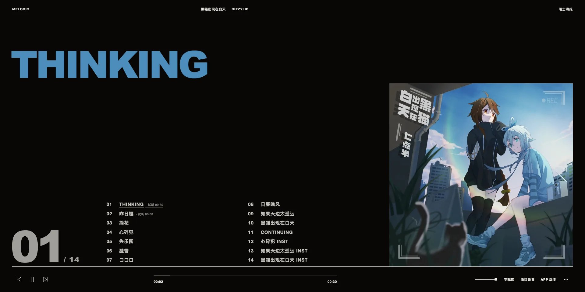
  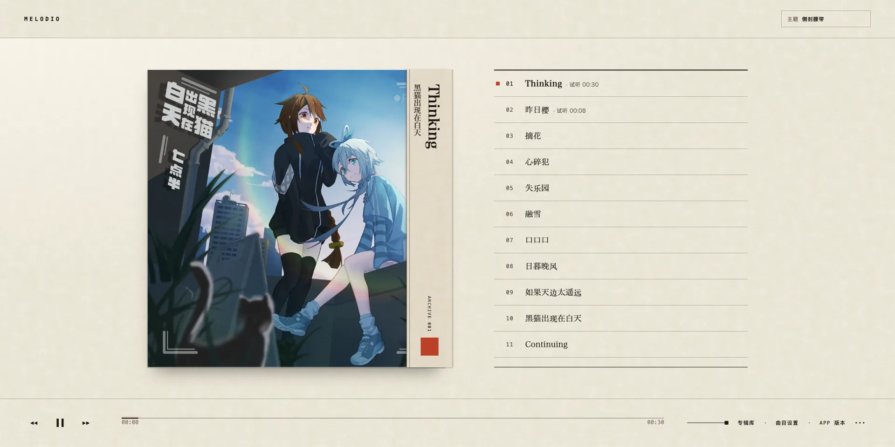
</p>
<p>
  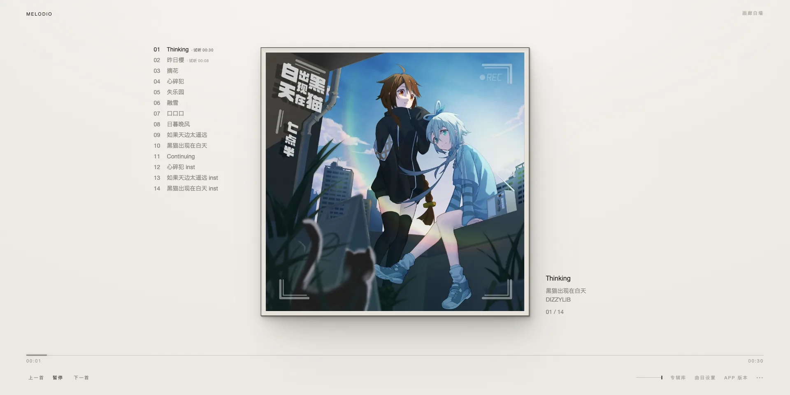
  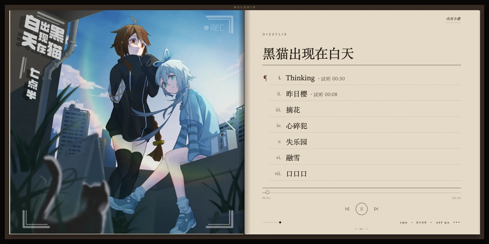
</p>

## PC 沉浸模式

<p>
  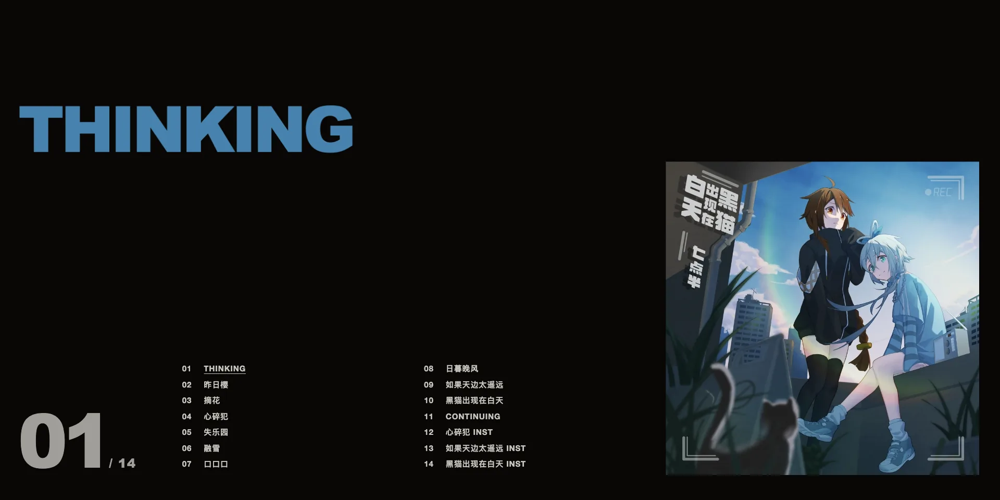
  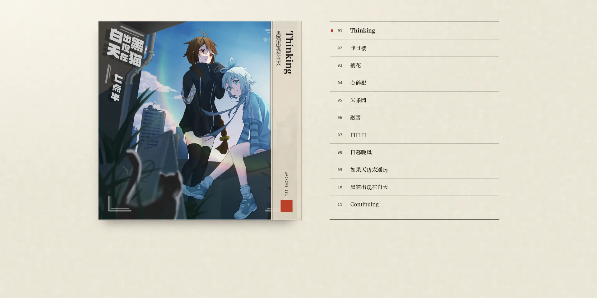
</p>
<p>
  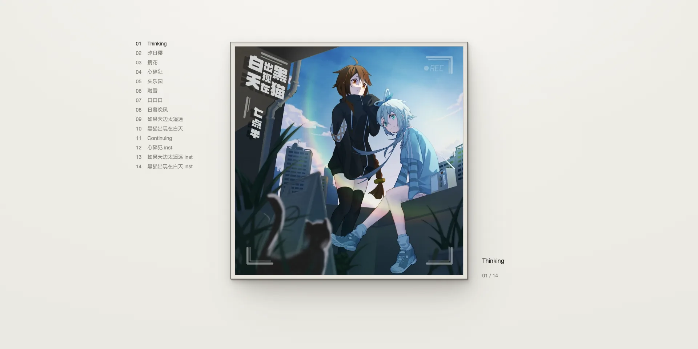
  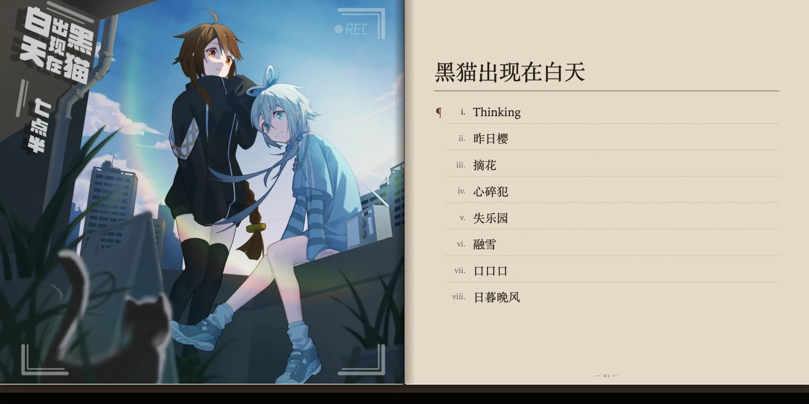
</p>

## 移动端

<p>
  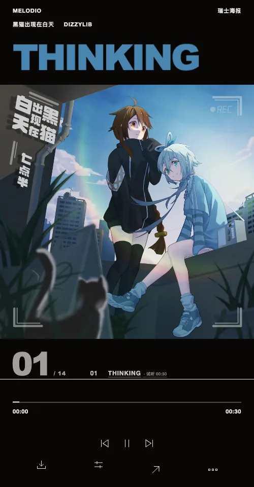
  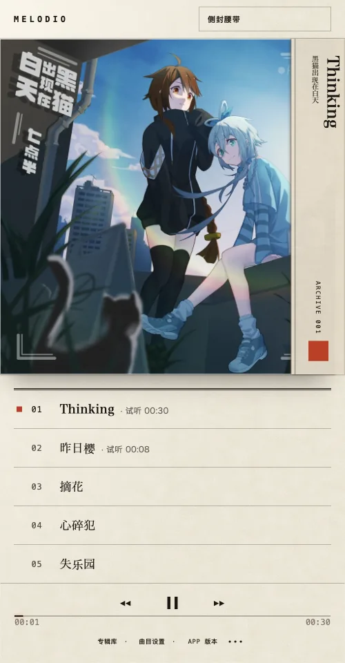
</p>
<p>
  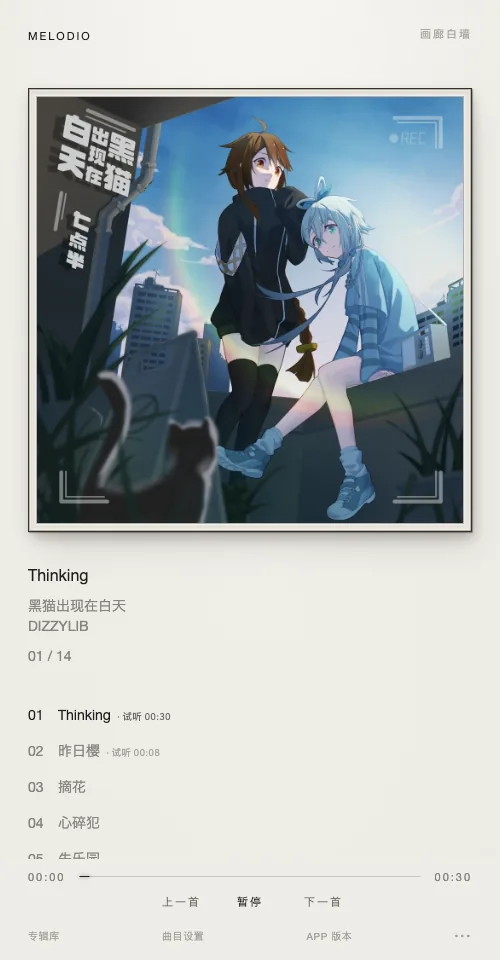
  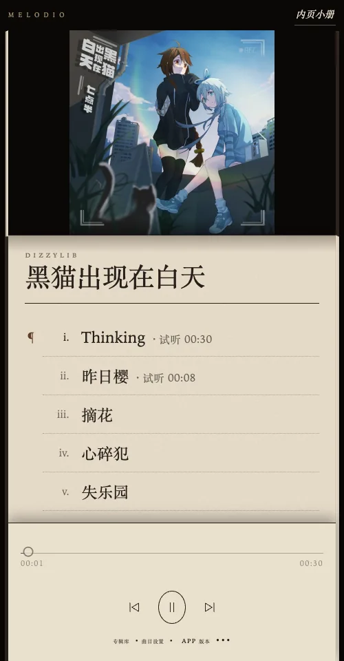
</p>

## 曲目试听

<p>
  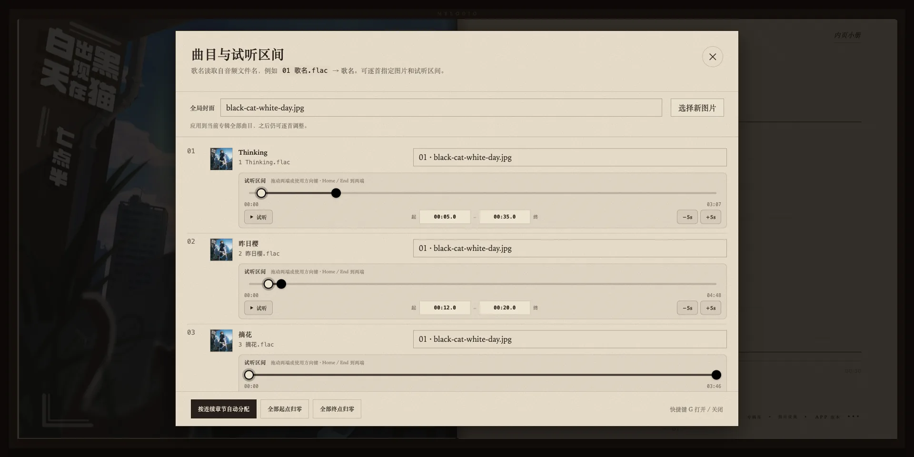
</p>

## 主题化下拉弹层

仅展示瑞士海报皮肤的语言弹层。

<p>
  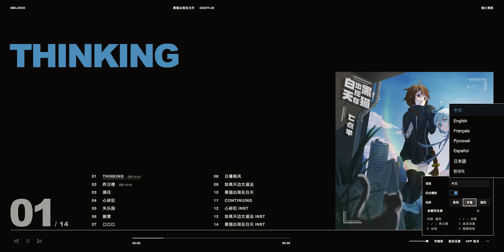
</p>

## 使用

浏览器本地专辑播放器。音频、图片和设置只在当前浏览器中处理，不上传服务器。

```bash
npm run dev
```

打开 `http://localhost:4173`，选择或拖入包含音频和图片的文件夹。文件名前导编号会自动配对，例如 `01 歌名.wav` 与 `01 cover.jpg`。曲目设置支持逐首换图、在一条时间线上拖动设置试听起止点，试听时长会显示在曲名后，配置会保存到当前浏览器缓存。

快捷键：空格播放/暂停，左右方向键切歌，上下方向键切换皮肤，`G` 打开曲目设置，`M` 调整动效，`H` 切换沉浸模式。

## 许可证

MIT，见 [LICENSE](LICENSE)。
